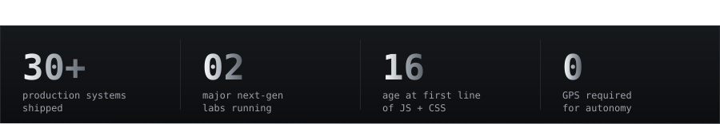
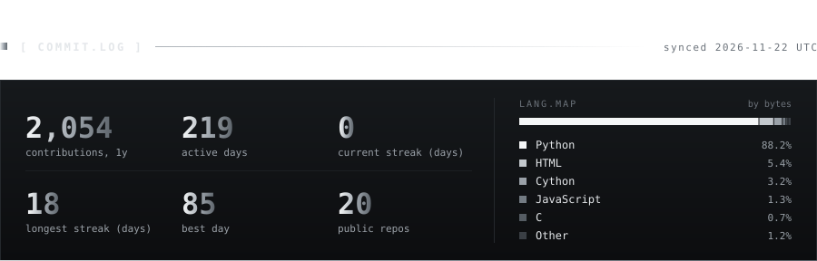

<div align="center">
  
</div>

<br/>

<div align="center">

<a href="https://ahkhan.online"></a>
<a href="https://www.nafrok.com"></a>
<a href="https://www.aixrobo.com"></a>
<a href="https://linkedin.com/in/ahmedhussainkhan"></a>
<a href="mailto:ahkhan.nafrok@gmail.com"></a>
<a href="https://twitter.com/AHMEDAlp15"></a>

</div>

<br/>

```yaml
whoami:   Ah Khan (Ra9)
origin:   Started coding at 16 with JS and CSS. No roadmap, just curiosity.
running:  2 major next-gen labs, NAFROK and AIxRobo
shipped:  30+ production systems
research: autonomous machines navigating hostile environments without GPS
```

<div align="center">
  
</div>

<div align="center">
  <a href="https://www.nafrok.com"></a>
</div>

<div align="center">
  
</div>

<div align="center">
  
</div>

<div align="center">
  
</div>

<div align="center">
  
</div>

<div align="center">
  
</div>

<div align="center">
<sub>ahkhan.nafrok@gmail.com &nbsp;//&nbsp; Bangalore, India</sub>
</div>
