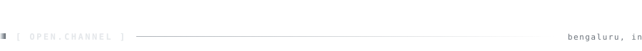

<div align="center">
  
</div>

<h1 align="center">Ahmed Hussain Khan (Ah Khan / Ra9)</h1>

<h3 align="center">Full-Stack Developer · AI/ML Engineer · Robotics Engineer · Bengaluru (Bangalore), India</h3>

<p align="center">
Ahmed Hussain Khan, known online as <strong>Ah Khan</strong> and <strong>Ra9</strong>, is a full-stack developer and AI/ML and robotics engineer based in Bengaluru, India. He founded and runs <a href="https://www.nafrok.com">NAFROK</a>, a next-gen web development lab, and <a href="https://www.aixrobo.com">AIxRobo</a>, a next-gen AI and robotics research lab. He has shipped 30+ production systems, and his research focuses on autonomous machines that navigate hostile, GPS-denied environments using computer vision and onboard AI.
</p>

<br/>

<div align="center">

<a href="https://ahkhan.online" title="Ah Khan portfolio website"></a>
<a href="https://www.nafrok.com" title="NAFROK web development lab"></a>
<a href="https://www.aixrobo.com" title="AIxRobo AI and robotics research lab"></a>
<a href="https://linkedin.com/in/ahmedhussainkhan" title="Ahmed Hussain Khan on LinkedIn"></a>
<a href="mailto:ahkhan.nafrok@gmail.com" title="Email Ah Khan"></a>
<a href="https://twitter.com/AHMEDAlp15" title="Ah Khan on X (Twitter)"></a>

</div>

<br/>

```yaml
whoami:      Ah Khan (Ra9), Ahmed Hussain Khan
roles:       Full-Stack Developer, AI/ML Engineer, Robotics Engineer
location:    Bengaluru (Bangalore), Karnataka, India
origin:      Started coding at 16 with JavaScript and CSS. No roadmap, just curiosity.
running:     2 major next-gen labs, NAFROK (web) and AIxRobo (AI + robotics)
shipped:     30+ production systems
research:    autonomous machines navigating hostile, GPS-denied environments
core_stack:  Python, TypeScript, Next.js, React, Node.js, FastAPI, PyTorch, TensorFlow, OpenCV
```

<div align="center">
  
</div>

## Labs

<div align="center">
  <a href="https://www.nafrok.com"></a>
</div>

- **[NAFROK](https://www.nafrok.com)**: web development lab building production websites and full-stack web applications with Next.js, React and Node.js.
- **[AIxRobo](https://www.aixrobo.com)**: AI and robotics research lab working on autonomous drones, rescue robotics, computer vision and GPS-denied navigation.

## Projects

<div align="center">
  
</div>

<!-- VERIFY each description below. Written from project names only. -->

- **AIxDrone**: autonomous drone navigation and computer vision research (Python, OpenCV, PyTorch).
- **AIxRescue**: AI-assisted search and rescue robotics for hostile environments.
- **SlateBooks**: MERN-stack e-commerce platform (MongoDB, Express, React, Node.js).
- **Retail Joints**: retail management software for stores and outlets.

## Tech stack

<div align="center">
  
</div>

- **Languages:** Python, JavaScript, TypeScript, C++, Kotlin
- **Frontend and mobile:** Next.js, React, Tailwind CSS, Android Studio
- **Backend and data:** Node.js, FastAPI, MongoDB, PostgreSQL, Redis
- **AI and robotics:** TensorFlow, PyTorch, OpenCV, Raspberry Pi, Arduino
- **DevOps and tools:** Docker, Linux, Git, Vercel, Figma

## Focus areas

Full-stack web development, machine learning and deep learning, computer vision, autonomous drones, search and rescue robotics, embedded systems on Raspberry Pi and Arduino, and GPS-denied navigation.

## GitHub activity

<div align="center">
  
</div>

<div align="center">
  
</div>

## Contact

<div align="center">
  
</div>

<div align="center">
<sub><a href="mailto:ahkhan.nafrok@gmail.com">ahkhan.nafrok@gmail.com</a> &nbsp;//&nbsp; Bengaluru (Bangalore), India &nbsp;//&nbsp; <a href="https://ahkhan.online">ahkhan.online</a></sub>
</div>
